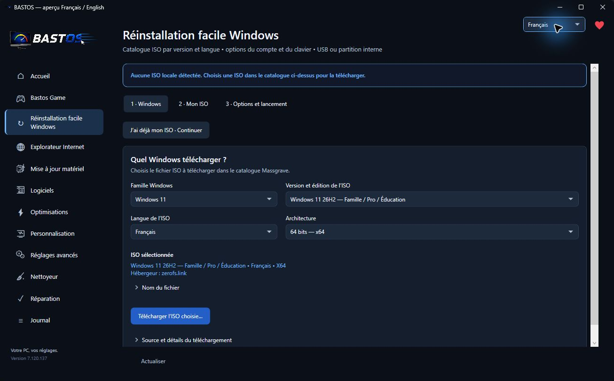
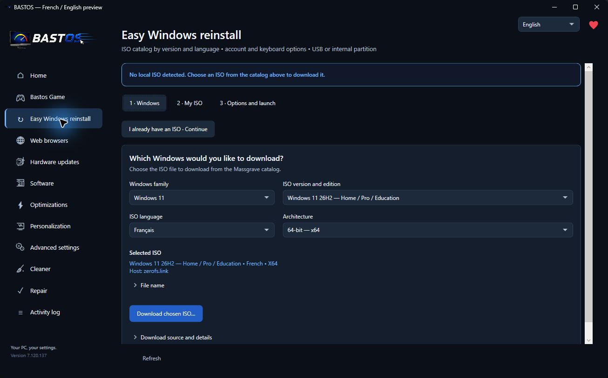
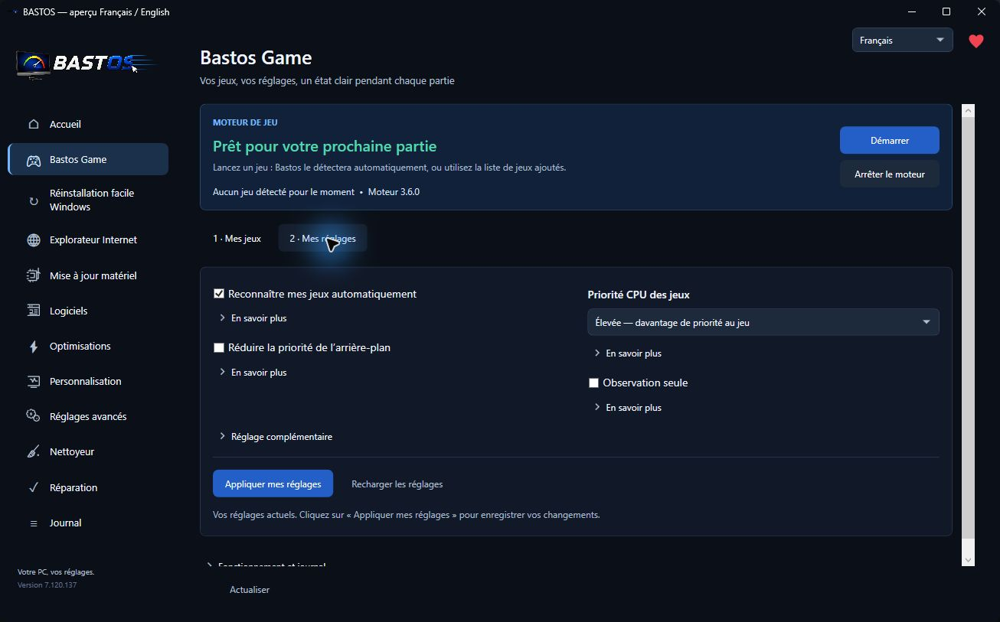

<a href="https://github.com/bastos85-Poly/BASTOS/releases/latest"><strong>Télécharger BASTOS</strong></a> · <a href="https://github.com/bastos85-Poly/BASTOS/issues">Faire un retour</a> · <a href="https://ko-fi.com/bastos85">❤️ Soutenir sur Ko-fi</a>

# Réinstallez Windows facilement, même sans connaissances techniques

### Sans clé USB ni matériel supplémentaire pour l’installation. Un parcours guidé en français ou en anglais.

> **Mon premier programme, un projet qui grandit avec vous.** BASTOS est encore en cours de développement. Vos retours, vos partages et votre soutien sur [Ko-fi](https://ko-fi.com/bastos85) m’aident à le faire progresser et à y consacrer davantage de temps.

**Pas besoin de savoir créer une clé USB bootable ou préparer les fichiers d’installation à la main. Choisissez votre Windows et laissez-vous guider, étape par étape.** BASTOS rassemble le téléchargement, les contrôles et la préparation dans une même application, directement depuis votre PC. **Français / English : les deux langues sont disponibles dès la version 7.120.137.**

L’objectif est simple : **rendre la réinstallation de Windows accessible, même si vous ne l’avez jamais faite.** Vous choisissez parmi les Windows proposés, BASTOS vous accompagne dans la préparation, puis vous consultez le bilan avant de confirmer. Les contrôles indiquent si votre PC remplit les conditions nécessaires.

**Et après ?** Retrouvez les optimisations gaming, la personnalisation de Windows et l’installation de vos logiciels au même endroit.

## Comment fonctionne l’installation sans clé USB ?

1. **Choisissez votre Windows.** Sélectionnez la version proposée, l’édition et la langue selon les choix disponibles. Le catalogue et les détails affichent la source du téléchargement ; vous pouvez aussi sélectionner une ISO compatible déjà téléchargée.
2. **Préparez l’installation sur le PC.** BASTOS vérifie l’image et les conditions nécessaires, puis prépare une zone temporaire sur le disque interne pour les fichiers d’installation. Vous n’avez pas de clé USB à créer pour ce parcours.
3. **Vérifiez le bilan et lancez la réinstallation.** Après votre confirmation, le PC redémarre dans l’environnement d’installation. Une fois le premier démarrage vérifié, l’espace temporaire est rendu à C: et l’environnement de récupération Windows est recréé.

Ce parcours nécessite un Windows encore accessible pour la préparation, un disque compatible et suffisamment d’espace disponible. Les contrôles de BASTOS déterminent si votre PC peut l’utiliser. **Sauvegardez vos données sur un autre support avant de confirmer une réinstallation.** Le choix d’une édition ne fournit pas de licence Windows ; son activation nécessite une licence adaptée.

## Ensuite, un Windows à votre goût, prêt pour vos jeux

BASTOS propose aussi des **optimisations pour votre environnement gaming**, des **personnalisations Windows** et un **catalogue de logiciels**. Choisissez les réglages utiles à votre configuration, adaptez l’apparence et retrouvez vos outils habituels depuis la même application.

**Nouveau en 7.120.138 :** dans **Optimisations → Jeux et performances**, la tuile **Désactiver les services** propose le profil de services Atom complet, avec aperçu, sauvegarde et restauration. Ce profil facultatif est agressif : il inclut sécurité, mises à jour, Bluetooth, impression et Xbox. Windows peut refuser certaines modifications ; les pilotes noyau sont exclus. [Lire le fonctionnement et les limites avant de l’appliquer](docs/features/services.md).

**Corrigé en 7.120.139 :** prise en charge des modèles de services par utilisateur et des nouvelles tentatives après un refus sans effet. Le bilan distingue les refus de Windows, les conflits et les erreurs ; les changements des modèles prennent effet à la prochaine session.

## Ce que vous pouvez faire

| Votre besoin | Ce que propose BASTOS |
| --- | --- |
| **Installer Windows sans clé USB** | Choix du Windows à télécharger, préparation sur le disque interne, contrôles et bilan avant de lancer la réinstallation. |
| **Optimiser votre environnement gaming** | Des réglages Windows et des outils liés au jeu et au matériel, à choisir selon votre configuration. Les gains dépendent du PC et des jeux ; aucun gain universel de FPS n’est garanti. |
| **Personnaliser Windows** | Mode sombre, transparence, Explorateur et autres réglages Windows dans une interface commune. |
| **Installer vos logiciels** | Un catalogue pour sélectionner et lancer l’installation de vos applications. Une connexion Internet est nécessaire ; certains éditeurs demandent une interaction. |
| **Comprendre votre PC** | Des informations sur le matériel et des outils de diagnostic, avec un journal pour consulter les résultats et les erreurs. |

*Ces visuels sont des illustrations de présentation, pas des captures de l’application.*

## Découvrez le menu avant de commencer

**Français et anglais sont maintenant disponibles dans la même application.** Choisissez **Français / English** en haut à droite : l’affichage change immédiatement et votre choix est mémorisé. Bastos Game reprend la même langue, y compris près de l’horloge. Ce menu ne change pas la langue du Windows que vous téléchargez.

*Capture de l’interface 7.120.137 : le menu reste à gauche, le choix de langue en haut à droite et les étapes du parcours au centre. Aucune installation n’est lancée en ouvrant cet écran.*

| Vous voulez… | Ouvrez… |
| --- | --- |
| Choisir Windows et préparer une réinstallation sans clé USB | **Réinstallation facile Windows** |
| Préparer vos réglages de jeu et suivre leur application | **Bastos Game** |
| Consulter les pistes de mises à jour et les téléchargements de pilotes | **Mise à jour matériel** |
| Installer un navigateur ou choisir vos logiciels | **Explorateur Internet / Logiciels** |
| Adapter Windows à votre usage | **Optimisations / Personnalisation / Réglages avancés** |
| Nettoyer, diagnostiquer ou retrouver le détail d’une opération | **Nettoyeur / Réparation / Journal** |

### Le parcours sans clé USB, à votre rythme

**1 · Windows** : choisissez parmi les versions, éditions et langues proposées, ou continuez avec une ISO compatible que vous possédez déjà. La source du téléchargement est indiquée dans l’application.

**2 · Mon ISO** : sélectionnez votre image Windows et laissez BASTOS en vérifier la compatibilité avant de poursuivre.

**3 · Options et lancement** : préparez les options proposées, choisissez le parcours sur partition interne et relisez le bilan. Le lancement de la réinstallation demande une confirmation distincte. Après vérification du premier démarrage, l’espace de la partition temporaire est rendu à C: et WinRE est recréé.

**Sauvegardez vos fichiers sur un autre support avant de confirmer.** Le parcours prépare et modifie les partitions ; les contrôles précisent si votre PC remplit les conditions nécessaires. Un Windows accessible, un disque compatible et suffisamment d’espace restent requis.

<strong>See the English interface / Voir l’interface anglaise</strong>

Choose **English** in the top-right menu. Select a Windows image, check your ISO, review the options, then confirm the separate reinstallation workflow. No USB drive is required for the supported internal-disk workflow. Back up your files first; compatibility and available space are checked before proceeding.

## Bastos Game : vos jeux, vos réglages, votre suivi

**Le module gaming intégré accompagne vos parties.** Ajoutez un jeu si nécessaire, choisissez vos réglages, puis démarrez le moteur. Bastos Game détecte les jeux pris en charge ou ajoutés, applique les réglages de processus autorisés et affiche un état récent. Vous retrouvez ses commandes depuis l’icône de notification près de l’horloge.

*Capture de l’interface 7.120.137. L’état et la version du moteur affichés dépendent du module en fonctionnement sur le PC.*

- **Mes jeux** : gérer les jeux suivis et les applications à ignorer.
- **Mes réglages** : choisir la priorité CPU, le traitement de l’arrière-plan et le mode observation.
- **Un suivi lisible** : consulter les actions réellement appliquées et les éventuels refus dans le journal.
- **La même langue partout dans BASTOS** : français ou anglais, jusque dans le module de notification.

Le moteur tente de restaurer les valeurs initiales à la fin du suivi. Les effets dépendent de votre PC et de vos jeux ; aucun gain universel de FPS n’est garanti.

**[Découvrir comment utiliser Bastos Game](docs/features/game.md)** · [Bastos Game in English](docs/images/bastos-game-en.png)

## Essayer BASTOS

1. Ouvrez la [dernière version publiée](https://github.com/bastos85-Poly/BASTOS/releases/latest).
2. Téléchargez **BASTOS-Setup-7.120.137.exe** pour cette version. Le fichier « Source code » est destiné au développement.
3. Fermez BASTOS s’il est déjà ouvert, puis lancez l’installateur.
4. Retrouvez **un seul raccourci BASTOS sur le Bureau**, ouvrez l’application et choisissez les fonctions qui vous intéressent.

**Configuration : Windows 11 x64.** Le runtime est inclus. Installer BASTOS n’applique aucun réglage Windows et ne lance pas une réinstallation du système. Les actions nécessitant des droits administrateur restent soumises à l’autorisation de Windows.

Les exécutables ne sont actuellement **pas signés** : Windows peut afficher un avertissement. Vérifiez la provenance du téléchargement et les empreintes fournies dans **SHA256SUMS.txt**.

## Un projet à faire progresser ensemble

Les vérifications et leurs limites sont détaillées dans **VERIFICATIONS.md**, joint à la [version publiée](https://github.com/bastos85-Poly/BASTOS/releases/latest). Les tests ne couvrent pas toutes les configurations matérielles.

**Français ou English : à vous de choisir.** Le menu en haut à droite change la langue de l’interface et mémorise votre préférence. Bastos Game, dans la zone de notification, reprend ce même choix. La langue de l’interface ne change pas le Windows que vous choisissez de télécharger.

Un problème, une idée ou un logiciel qui ne s’installe pas ? [Ouvrez une issue](https://github.com/bastos85-Poly/BASTOS/issues) en indiquant la version de BASTOS, l’action tentée, le résultat attendu et le message obtenu. Masquez vos données personnelles dans les captures. Ne joignez aucun journal brut, mot de passe ou clé de récupération BitLocker.

## Avant une réinstallation de Windows

Ce parcours modifie le système et les partitions : **sauvegardez vos données sur un autre support avant de le confirmer**. La partition **D: BASTOS_RECOVERY** est temporaire. Après vérification du premier démarrage, son espace est automatiquement rendu à C: et WinRE est recréé. **Les données restant sur ce D: seront effacées.** Consultez le bilan affiché dans l’application avant de lancer ce parcours.

La désinstallation de BASTOS conserve les données et les sauvegardes ; elle ne restaure pas automatiquement les réglages que vous avez appliqués.

## Soutenir le développement

**BASTOS est mon premier programme.** Je le développe avec l’envie de rendre la réinstallation de Windows plus accessible et de proposer des outils utiles pour le gaming et la personnalisation. Le projet est encore en cours de développement : il évolue, et des bugs peuvent subsister malgré les tests.

J’aimerais pouvoir **m’investir à fond dans BASTOS**. Pour cela, j’ai besoin de soutien : vos dons peuvent m’aider à dégager plus de temps pour développer les fonctionnalités, corriger les problèmes et poursuivre les tests.

Vous pouvez aussi m’aider sans faire de don : en partageant le projet, en signalant un bug avec des explications précises ou en proposant une amélioration. Merci à celles et ceux qui participent à cette aventure.

**[❤️ Offrir un coup de pouce sur Ko-fi](https://ko-fi.com/bastos85)** — le soutien est facultatif.

## Sources, licence et confidentialité

Les sources principales sont disponibles sous **GPL-3.0-or-later** ; les composants tiers conservent leurs licences propres. Le projet utilise C#/WPF et .NET 8 x64, avec un module de jeu C++.

- [Installation et construction des sources](docs/INSTALLATION-ET-SOURCES.md)
- [Guide de construction](docs/BUILD.md) et [validation des livraisons](Build/README-ReleaseValidation.md)
- [Contribuer](CONTRIBUTING.md)
- [Nouveautés](docs/CHANGELOG.md) et [langues de l’interface](docs/INTERFACE-LANGUAGES.md)
- [Confidentialité](CONFIDENTIALITE.md) et [signalement de sécurité](SECURITY.md)
- [Licence](LICENSE.txt)

Le dépôt et les fichiers publiés ont fait l’objet d’une revue de confidentialité. Les journaux personnels, sauvegardes et médias Windows sont exclus. Cette revue ne garantit pas l’absence de vulnérabilités.
