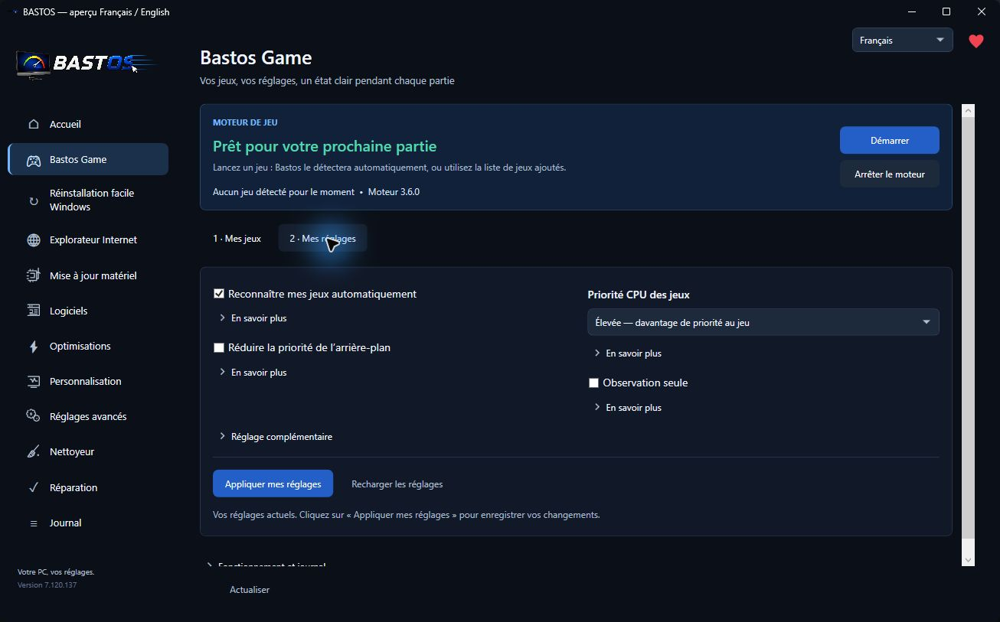
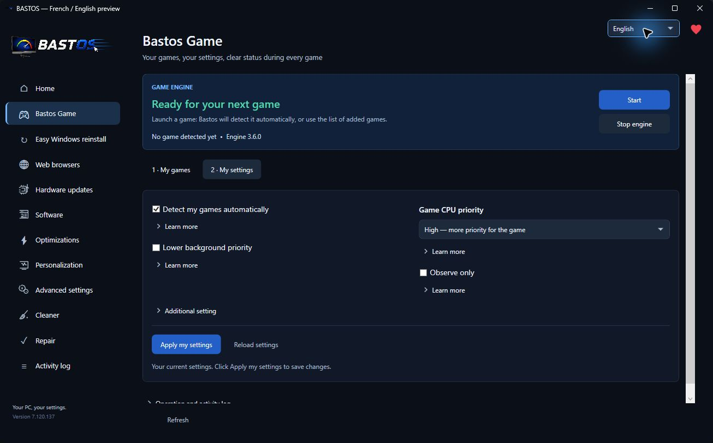

# Bastos Game : préparez votre prochaine partie

Bastos Game est le module gaming de BASTOS. Il suit les jeux détectés et applique les réglages de processus que vous avez autorisés. Il reste accessible depuis son icône près de l’horloge, sans garder la fenêtre principale ouverte.

*Capture de l’interface 7.120.137. L’état et la version du moteur affichés dépendent du module en fonctionnement sur le PC.*

## Commencer

1. Ouvrez **Bastos Game** dans le menu de gauche.
2. Dans **Mes jeux**, vérifiez les jeux reconnus. Utilisez **Ajouter un jeu** pour sélectionner son exécutable si nécessaire. Les applications de la liste d’exclusions sont ignorées.
3. Dans **Mes réglages**, choisissez la priorité CPU et les options qui conviennent à votre usage. Les changements sont enregistrés avec **Appliquer mes réglages**.
4. Cliquez sur **Démarrer**, puis lancez votre jeu normalement. L’état indique si le moteur dispose d’un résultat récent et si une partie est détectée.
5. Retrouvez les réglages et le suivi depuis l’icône de notification près de l’horloge. Consultez le journal pour savoir quelles actions ont réussi ou ont été refusées.

## Comprendre les réglages

| Réglage | Utilité |
| --- | --- |
| Reconnaître mes jeux automatiquement | Repérer les jeux pris en charge ; un ajout manuel reste possible. |
| Priorité CPU des jeux | Donner au processus du jeu la priorité choisie dans les limites autorisées par Windows. |
| Réduire la priorité de l’arrière-plan | Réduire la priorité CPU des applications suivies en arrière-plan pendant une partie. Option à choisir selon votre usage. |
| Observation seule | Observer la détection sans appliquer d’optimisation aux processus ; demander la restauration des modifications précédentes. |
| Applications à ignorer | Conserver certaines applications hors du suivi. |

À la fin du suivi, le moteur tente de restaurer les valeurs initiales. Un refus de Windows ou d’un anti-cheat reste un refus : le journal permet de le voir. Bastos Game n’injecte pas de code dans les jeux et ne remplace pas leurs réglages graphiques.

## Français / English

Le menu de langue de BASTOS s’applique aussi au menu de notification et aux réglages de Bastos Game. Le choix est mémorisé ; aucune traduction en ligne n’est nécessaire.

## Mesurer les résultats

Les effets dépendent du matériel, du jeu et des autres applications. Aucun gain universel de FPS n’est garanti. Le mode observation et les outils de comparaison permettent d’examiner vos propres mesures dans des conditions aussi proches que possible.

[Télécharger BASTOS](https://github.com/bastos85-Poly/BASTOS/releases/latest) · [Retour à la présentation](../../README.md) · [Soutenir le développement](https://ko-fi.com/bastos85)
